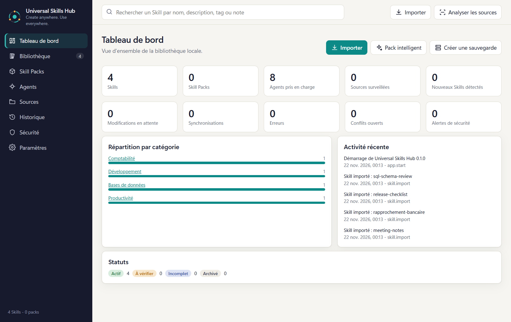
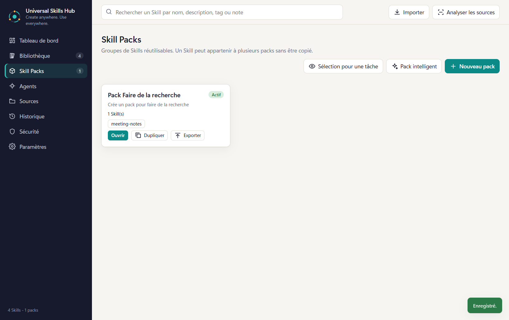
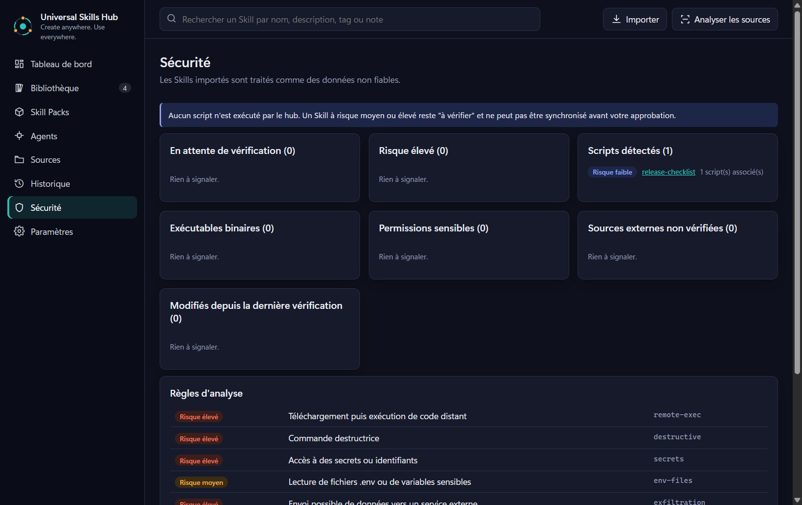

<p align="center">
  
</p>

<h1 align="center">Universal Skills Hub</h1>

<p align="center"><strong>Create anywhere. Use everywhere.</strong></p>

<p align="center">Gestionnaire universel de Skills pour agents d'intelligence artificielle. Découvrir, organiser, versionner, regrouper et synchroniser ses Skills entre les agents compatibles, depuis une bibliothèque locale unique.</p>

---

## Le problème

Les Skills (dossiers `SKILL.md` du format Agent Skills, instructions, scripts et ressources) se dispersent vite : un dossier pour Claude Code, un autre pour Codex, des règles Cursor dans chaque projet, des archives téléchargées depuis Claude.ai, des textes copiés depuis une conversation ChatGPT. Il devient difficile de savoir quelle version est la bonne, où un Skill est installé, s'il existe en double ou s'il contient un script douteux.

## Ce que fait Universal Skills Hub

Universal Skills Hub rassemble tous vos Skills dans une bibliothèque locale. Il les classe, conserve leurs versions, signale les doublons et les risques, puis les installe chez les agents qui savent les lire. Il fonctionne hors ligne, sans compte et sans télémétrie. Il ne dépend d'aucun fournisseur d'IA.

État actuel : version **0.1.0**, premier MVP utilisable. Le détail de ce qui est terminé, testé ou planifié se trouve dans [PROJECT_STATUS.md](PROJECT_STATUS.md).

## Fonctionnalités disponibles

| Domaine | Fonctionnalité | Statut |
| --- | --- | --- |
| Bibliothèque | Fiche complète par Skill, recherche globale, filtres (catégorie, tag, pack, agent, statut, sécurité), tri | Opérationnel, testé |
| Import | Dossier, fichier, archive ZIP, copier-coller, dépôt Git (https ou git@), URL HTTPS, Skill Pack | Opérationnel, testé (Git et URL : voir limites) |
| Détection | Sources surveillées : nouveaux, modifiés, déplacés, renommés, supprimés, doublons, incomplets | Opérationnel, testé |
| Surveillance | Modes manuel, au démarrage, temps réel (`fs.watch`), périodique, par source | Opérationnel ; le mode temps réel n'a pas de test automatisé |
| Classification | 28 catégories modifiables, plusieurs catégories par Skill, niveau de confiance, correction manuelle | Opérationnel, testé |
| Doublons | Doublons exacts, contenus identiques sous un autre nom, variantes, homonymes | Opérationnel, testé |
| Versions | Version à chaque modification, comparaison ligne par ligne, restauration sans perte | Opérationnel, testé |
| Skill Packs | Création, ordre, duplication, activation, pack par défaut, agents et projets associés, règles, import et export | Opérationnel, testé |
| Pack intelligent | Proposition de pack à partir d'une phrase, avec raisons, couverture des besoins et besoins manquants | Opérationnel (moteur par mots-clés, local) |
| Sélection | Choix des Skills pour une tâche, exclusions, ajouts manuels, raisons, conflits | Opérationnel, testé |
| Synchronisation | Plan par destination : installer, mettre à jour, conflits, suppressions, sauvegarde avant écrasement | Opérationnel, testé |
| Adaptateurs | Claude Code, Claude.ai et Desktop (ZIP), Codex, VS Code / Copilot, Cursor (.mdc), ChatGPT (Markdown), dossier personnalisé, adaptateurs JSON | Voir [COMPATIBILITY.md](COMPATIBILITY.md) |
| Sécurité | Analyse statique, statut "à vérifier", blocage de la synchronisation, aucun script exécuté | Opérationnel, testé |
| Sauvegarde | Archive ZIP vérifiable (SHA-256), restauration sélective, sauvegarde automatique avant restauration | Opérationnel, testé |
| Historique | Journal local de toutes les opérations | Opérationnel |
| Interface | Application desktop, modes clair et sombre, français et anglais | Opérationnel, test de fumée automatisé |
| Contrôle rédactionnel | Blocage des caractères `U+2014` et `U+2013` en local, en hook Git et en CI | Opérationnel, testé |

## Captures d'écran

Captures réelles de la version 0.1.0, produites par `npm run test:smoke` sur les Skills d'exemple du dépôt.

<p align="center">
  
</p>
<p align="center">
  
  
</p>

## Fonctionnement

1. **Sources** : vous indiquez des dossiers à surveiller (par exemple `~/.claude/skills`). Le hub les lit sans jamais les modifier.
2. **Bibliothèque** : chaque Skill importé est copié dans le dossier de données de l'application, analysé, classé et versionné.
3. **Packs** : vous regroupez des Skills par usage. Un Skill peut appartenir à plusieurs packs sans être copié.
4. **Destinations** : vous reliez un dossier d'agent (par exemple `~/.claude/skills`) à une sélection de Skills ou de packs. Le hub calcule un plan de synchronisation et l'applique après votre validation.

Le hub compare trois états pour chaque Skill installé : la copie de la bibliothèque, la copie écrite lors de la dernière installation et la copie présente sur le disque. Une modification faite chez l'agent devient un conflit. Elle n'est jamais écrasée en silence, et toute copie remplacée est d'abord sauvegardée.

## Agents pris en charge

| Agent | Niveau | Méthode |
| --- | --- | --- |
| Claude Code | Natif | Dossiers `~/.claude/skills` et `.claude/skills` |
| Claude Code (plugins) | Natif, lecture seule | Lecture de `~/.claude/plugins/marketplaces` |
| Claude.ai et Claude Desktop | Manuel | Archive ZIP à téléverser dans l'application |
| Codex (OpenAI) | Non vérifié | `~/.codex/skills`, `~/.agents/skills`, `.agents/skills` |
| VS Code / GitHub Copilot | Non vérifié | `.github/skills`, `~/.copilot/skills` |
| Cursor | Via adaptateur | Conversion en règle `.cursor/rules/<nom>.mdc` |
| ChatGPT | Manuel | Export Markdown, import par copier-coller ou fichier |
| Agent personnalisé | Natif | Tout dossier au format Agent Skills, ou adaptateur JSON déclaratif |

"Non vérifié" signifie que les chemins suivent la documentation des éditeurs, mais que leur lecture par l'agent n'a pas été testée par ce projet. Détails et limites dans [COMPATIBILITY.md](COMPATIBILITY.md).

## Installation

Sous Windows, le plus simple est de télécharger la version portable ou l'installateur depuis la page [Releases](https://github.com/ATSU-ADJOTO007/universal-skills-hub/releases).

Depuis les sources : Windows 10 ou 11, macOS ou Linux, [Node.js](https://nodejs.org) 20 ou plus récent, Git.

```powershell
git clone https://github.com/ATSU-ADJOTO007/universal-skills-hub.git
cd universal-skills-hub
npm install
npm start
```

`npm install` télécharge Electron et active les hooks Git du dépôt. Un exécutable Windows portable peut être produit avec `npm run dist:win`. Toutes les méthodes, la mise à jour et la désinstallation sont décrites dans [INSTALL.md](INSTALL.md).

## Utilisation rapide

1. Ouvrez **Sources** : le hub propose les dossiers d'agents trouvés sur l'ordinateur. Ajoutez-en un, puis cliquez sur **Analyser**.
2. Sélectionnez les Skills détectés et importez-les.
3. Dans **Bibliothèque**, ouvrez un Skill pour voir sa fiche, ses fichiers, ses versions et son analyse de sécurité.
4. Dans **Skill Packs**, créez un pack ou décrivez un besoin au **pack intelligent**.
5. Dans **Agents**, ajoutez une destination, choisissez les Skills ou packs, vérifiez le plan puis appliquez.

Guide complet : [USAGE.md](USAGE.md).

## Commandes

| Commande | Rôle |
| --- | --- |
| `npm start` | Lance l'application desktop |
| `npm test` | Tests unitaires et d'intégration (`node:test`) |
| `npm run test:smoke` | Démarre l'application réelle, ouvre chaque vue et exécute des parcours utilisateur |
| `npm run check:writing` | Contrôle des tirets interdits (bloquant) |
| `npm run check:secrets` | Recherche de secrets et de fichiers sensibles (bloquant) |
| `npm run check:quality` | Avertissements de qualité rédactionnelle (non bloquant) |
| `npm run check` | Contrôles bloquants et tests, enchaînés |
| `npm run cli -- <commande>` | Interface en ligne de commande (`info`, `list`, `import`, `agents`, `scan`, `backup`, ...) |
| `npm run dist:win` | Exécutable Windows portable et installateur NSIS |

## Sécurité

Les Skills importés sont traités comme des données non fiables. L'application n'exécute aucun script de Skill : elle n'a pas de fonction pour le faire. Une analyse statique repère les téléchargements suivis d'exécution, les accès aux secrets, les tentatives d'exfiltration, les instructions qui cherchent à désactiver des protections, le code obfusqué et les exécutables. Un Skill à risque moyen ou élevé reste "à vérifier" et ne peut pas être synchronisé avant votre approbation. Voir [SECURITY.md](SECURITY.md).

## Confidentialité

Toutes les données restent dans un dossier local, en JSON, Markdown et ZIP. Aucun compte, aucune télémétrie, aucun envoi automatique. Le réseau n'est utilisé que si vous importez depuis une URL ou un dépôt Git, et uniquement vers l'adresse saisie.

## Contrôle rédactionnel

Le projet interdit les caractères `U+2014` (tiret cadratin) et `U+2013` (tiret demi-cadratin) dans ses contenus. Le script `scripts/check-writing.mjs` les recherche, affiche le fichier, la ligne, la colonne et un extrait, puis retourne le code 1. Il est appelé par le hook `pre-commit`, le hook `pre-push`, la CI et le workflow de release. Détails : [docs/QUALITY_CHECKS.md](docs/QUALITY_CHECKS.md).

```powershell
npm run check:writing
```

## Documentation

- [INSTALL.md](INSTALL.md) : installation, compilation, mise à jour, désinstallation
- [USAGE.md](USAGE.md) : guide d'utilisation
- [ARCHITECTURE.md](ARCHITECTURE.md) : modules et flux de données
- [COMPATIBILITY.md](COMPATIBILITY.md) : agents, formats, chemins, limites
- [SECURITY.md](SECURITY.md) : modèle de sécurité et signalement
- [CONTRIBUTING.md](CONTRIBUTING.md) : contribuer
- [docs/DEVELOPMENT.md](docs/DEVELOPMENT.md) : guide de développement
- [docs/ADAPTERS.md](docs/ADAPTERS.md) : ajouter un agent
- [docs/QUALITY_CHECKS.md](docs/QUALITY_CHECKS.md) : contrôles qualité
- [ROADMAP.md](ROADMAP.md), [CHANGELOG.md](CHANGELOG.md), [FAQ.md](FAQ.md), [PROJECT_STATUS.md](PROJECT_STATUS.md)

## Limites connues

- Le pack intelligent et la sélection reposent sur des mots-clés et des règles locales, sans modèle de langage. Ils expliquent leurs choix mais peuvent manquer des Skills décrits avec un autre vocabulaire.
- La compatibilité Codex, VS Code / Copilot et l'usage natif des Agent Skills par Cursor ne sont pas vérifiés sur une installation réelle.
- Le contenu des conversations Claude.ai ou ChatGPT n'est jamais lu : l'import passe par un fichier, une archive ou un copier-coller.
- Les paquets macOS et Linux sont configurés mais n'ont pas été construits ni testés.

## English summary

Universal Skills Hub is a local desktop application that gathers AI agent skills (Agent Skills `SKILL.md` folders and related files) in one library. It imports skills from folders, archives, Git and pasted text, classifies them, keeps every version, detects duplicates and risky content, groups skills into packs and synchronizes them to agent folders with conflict detection and backups. It runs offline, needs no account and sends no telemetry. MIT licensed.

## Licence

[MIT](LICENSE). Copyright (c) ADJOTO ATSU AMETEPE BERNARD.

## Auteur

Projet créé et maintenu par **ADJOTO ATSU AMETEPE BERNARD**.
